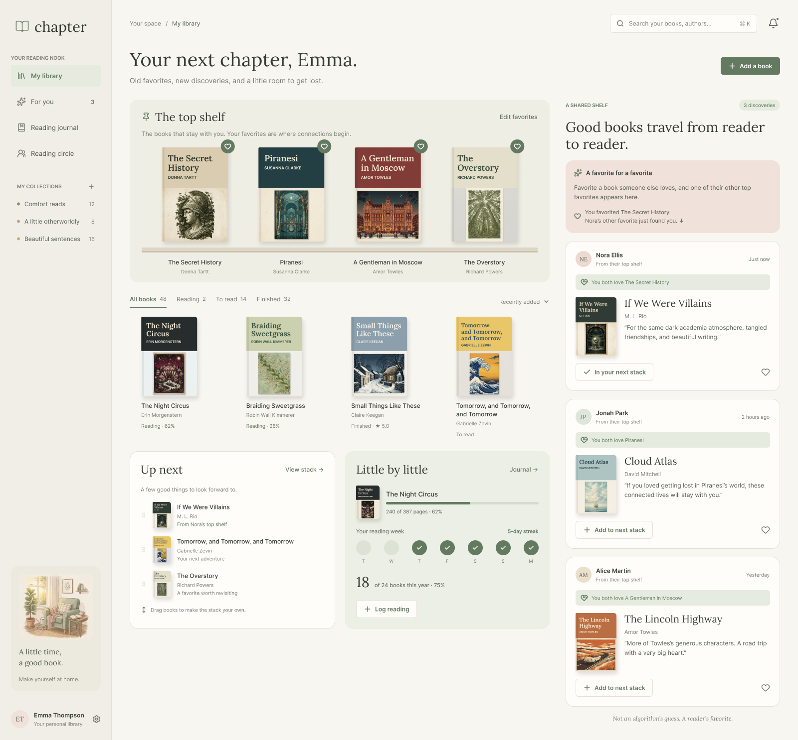

# Your startup name here

[My Notes](notes.md)

This is an interactive, digital personal library designed for book lovers who want to organize their reading journey and connect with others through shared tastes. Users can manage their personal virtual bookshelf by pinning their top favorites to the top shelf and curating a stack of books they intend to read next. What makes my project unique is its real-time social layer. When you favorite a book that another user loves, it instantly recommends one of their other top favorites directly to your feed. It’s a seamless way to track your reading habits and discover your next favorite book through reader-to-reader recommendations.

### Elevator pitch

This is an interactive, digital personal library designed for book lovers who want to organize their reading journey and connect with others through shared tastes. Users can manage their personal virtual bookshelf by pinning their top favorites to the top shelf and curating a stack of books they intend to read next. What makes my project unique is its real-time social layer. When you favorite a book that another user loves, it instantly recommends one of their other top favorites directly to your feed. It’s a seamless way to track your reading habits and discover your next favorite book through reader-to-reader recommendations.

### Design

### Key features

- **Interactive Virtual Bookshelf:** Visual shelf layout separating top-shelf favorites, already-read books, and stacks of intended reads.
- **User Authentication:** Secure account creation, login, and session persistence.
- **Third-Party Book Search:** Live title, author, and cover art search using external library APIs.
- **Real-Time Peer Recommendations:** Automatic cross-matching of favorite books between users delivered via instant real-time notifications.

### Technologies

I am going to use the required technologies in the following ways.

- **HTML** - Uses correct, semantic HTML5 structure across the application (e.g., \<header>, \<main>, \<nav>, \<section>, \<footer>). Provides a single-page application (SPA) layout shell with clear sectioning for login views, the primary virtual bookshelf, reading stacks, and notification banners.
- **CSS** - Application styling that is clean, modern, and responsive across varying screen sizes (mobile, tablet, desktop) using Flexbox and CSS Grid. Uses a cozy book-themed color palette with strong contrast, thoughtful whitespace, and smooth CSS transitions/animations when organizing or moving books between shelves.
- **React** - Frontend single-page application built with React components and dynamic client-side routing. Key modular components would include user authorization, bookshelves, reading stacks, the search function, and a notification banner.

- **Service** - Backend REST service providing functional endpoints to support application features:

    - User Management: Authentication endpoints for user registration, login, logout, and token validation.

    - Shelf Operations: Endpoints to create, retrieve, update, and delete books on a user's shelves or reading stack.

    - Recommendation Logic: Server-side comparison endpoints to detect shared favorites across users.

    - Third-Party Service: Server-side integration with the Open Library API ([https://openlibrary.org/search.json](https://openlibrary.org/search.json)) to fetch book metadata, publication details, and high-resolution cover images.
- **DB** - Persistent database storage (MongoDB/PostgreSQL) used to render application data, including:

    - User profile records and securely hashed credentials.

    - Master book metadata records (titles, authors, cover URLs, external API IDs).

    - Relational mappings linking users to their shelves and stack items (indicating shelf status: favorite, read, or future_reading).
- **WebSocket** - Real-time server-to-client communication connection:

    - When a user adds a book to their favorites shelf, the server checks if that title exists on another user's favorites shelf.

    - Upon a match, the server broadcasts an immediate WebSocket message to trigger a real-time notification recommending another favorite book from the matching user's shelf.

## 🚀 Specification Deliverable

For this deliverable I did the following. I checked the box `[x]` and added a description for things I completed.

- [x] I completed the prerequisites for this deliverable (Git commit requirement)
- [x] Proper use of Markdown
- [x] A concise and compelling elevator pitch
- [x] Description of key features
- [x] Description of how you will use each technology including your 3rd party API and use of WebSocket
- [x] One or more rough sketches of your application. Images must be embedded in this file using Markdown image references.

## 🚀 AWS deliverable

For this deliverable I did the following. I checked the box `[x]` and added a description for things I completed.

- [ ] **Rented EC2 server** - I did not complete this part of the deliverable.
- [ ] **Leased domain name** - I did not complete this part of the deliverable.
- [ ] **Server accessible** from my domain: [https://yourdomainnamehere.click](https://yourdomainnamehere.click) - I did not complete this part of the deliverable.

## 🚀 HTML deliverable

For this deliverable I did the following. I checked the box `[x]` and added a description for things I completed.

- [ ] I completed the prerequisites for this deliverable (Simon deployed, GitHub link, Git commits)
- [ ] **HTML pages** - I did not complete this part of the deliverable.
- [ ] **Proper HTML element usage** - I did not complete this part of the deliverable.
- [ ] **Links** - I did not complete this part of the deliverable.
- [ ] **Text** - I did not complete this part of the deliverable.
- [ ] **3rd party API placeholder** - I did not complete this part of the deliverable.
- [ ] **Images** - I did not complete this part of the deliverable.
- [ ] **Login placeholder** - I did not complete this part of the deliverable.
- [ ] **DB data placeholder** - I did not complete this part of the deliverable.
- [ ] **WebSocket placeholder** - I did not complete this part of the deliverable.

## 🚀 CSS deliverable

For this deliverable I did the following. I checked the box `[x]` and added a description for things I completed.

- [ ] I completed the prerequisites for this deliverable (Simon deployed, GitHub link, Git commits)
- [ ] **Visually appealing colors and layout. No overflowing elements.** - I did not complete this part of the deliverable.
- [ ] **Use of a CSS framework** - I did not complete this part of the deliverable.
- [ ] **All visual elements styled using CSS** - I did not complete this part of the deliverable.
- [ ] **Responsive to window resizing using flexbox and/or grid display** - I did not complete this part of the deliverable.
- [ ] **Use of a imported font** - I did not complete this part of the deliverable.
- [ ] **Use of different types of selectors including element, class, ID, and pseudo selectors** - I did not complete this part of the deliverable.

## 🚀 React part 1: Routing deliverable

For this deliverable I did the following. I checked the box `[x]` and added a description for things I completed.

- [ ] I completed the prerequisites for this deliverable (Simon deployed, GitHub link, Git commits)
- [ ] **Bundled using Vite** - I did not complete this part of the deliverable.
- [ ] **Components** - I did not complete this part of the deliverable.
- [ ] **Router** - I did not complete this part of the deliverable.

## 🚀 React part 2: Reactivity deliverable

For this deliverable I did the following. I checked the box `[x]` and added a description for things I completed.

- [ ] I completed the prerequisites for this deliverable (Simon deployed, GitHub link, Git commits)
- [ ] **All functionality implemented or mocked out** - I did not complete this part of the deliverable.
- [ ] **Hooks** - I did not complete this part of the deliverable.

## 🚀 Service deliverable

For this deliverable I did the following. I checked the box `[x]` and added a description for things I completed.

- [ ] I completed the prerequisites for this deliverable (Simon deployed, GitHub link, Git commits)
- [ ] **Node.js/Express HTTP service** - I did not complete this part of the deliverable.
- [ ] **Static middleware for frontend** - I did not complete this part of the deliverable.
- [ ] **Calls to third party endpoints** - I did not complete this part of the deliverable.
- [ ] **Backend service endpoints** - I did not complete this part of the deliverable.
- [ ] **Frontend calls service endpoints** - I did not complete this part of the deliverable.
- [ ] **Supports registration, login, logout, and restricted endpoint** - I did not complete this part of the deliverable.
- [ ] **Uses BCrypt to hash passwords** - I did not complete this part of the deliverable.

## 🚀 DB deliverable

For this deliverable I did the following. I checked the box `[x]` and added a description for things I completed.

- [ ] I completed the prerequisites for this deliverable (Simon deployed, GitHub link, Git commits)
- [ ] **Stores data in MongoDB** - I did not complete this part of the deliverable.
- [ ] **Stores credentials in MongoDB** - I did not complete this part of the deliverable.

## 🚀 WebSocket deliverable

For this deliverable I did the following. I checked the box `[x]` and added a description for things I completed.

- [ ] I completed the prerequisites for this deliverable (Simon deployed, GitHub link, Git commits)
- [ ] **Backend listens for WebSocket connection** - I did not complete this part of the deliverable.
- [ ] **Frontend makes WebSocket connection** - I did not complete this part of the deliverable.
- [ ] **Data sent over WebSocket connection** - I did not complete this part of the deliverable.
- [ ] **WebSocket data displayed** - I did not complete this part of the deliverable.
- [ ] **Application is fully functional** - I did not complete this part of the deliverable.
